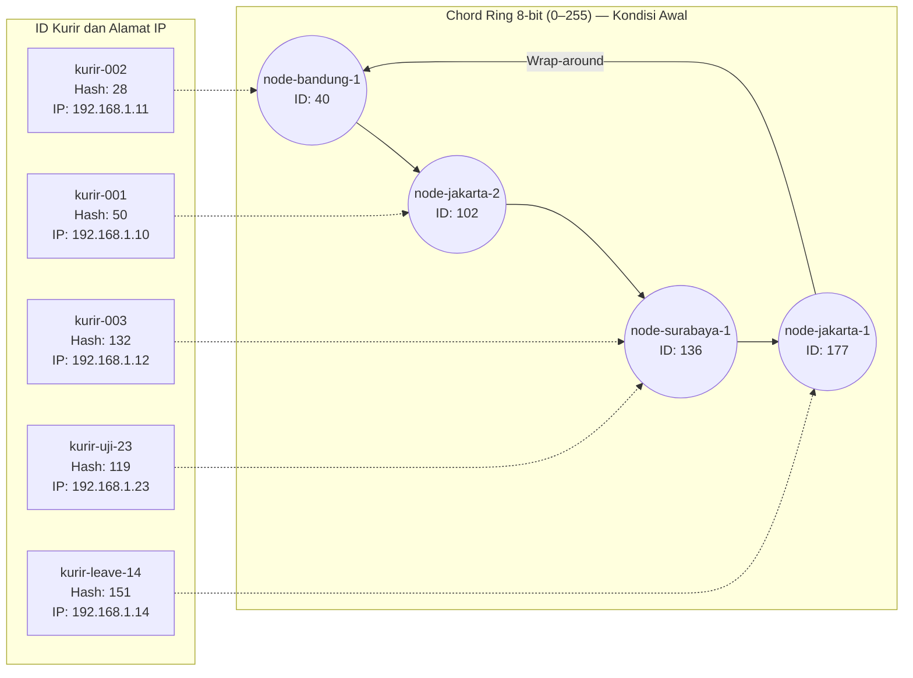
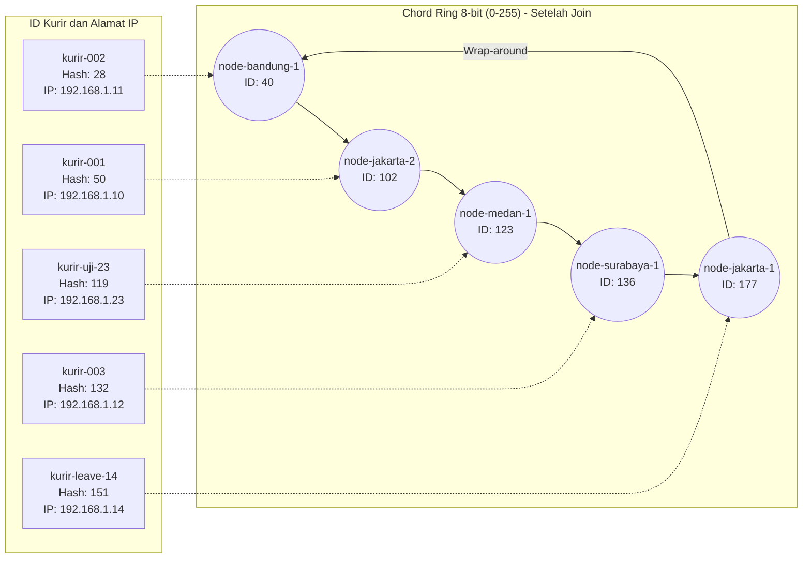
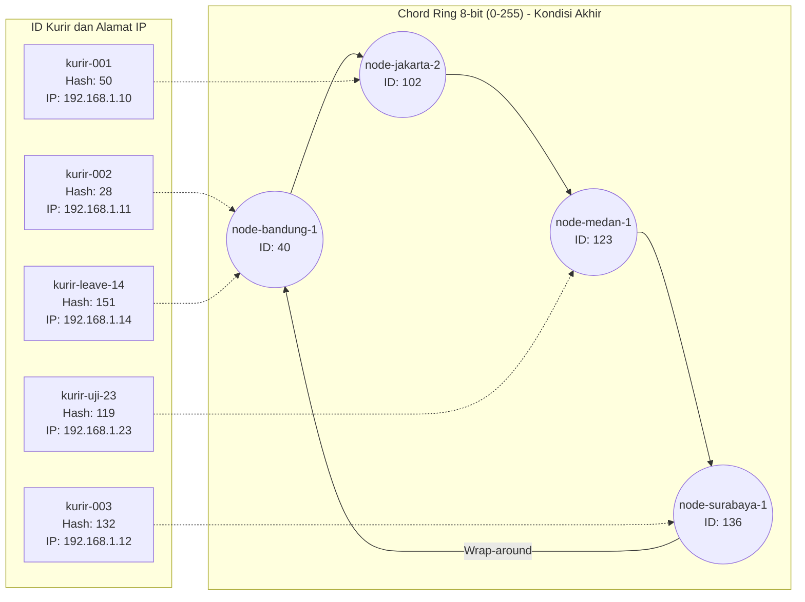

# Tugas 6 (Pekan 6) — Penamaan & Resolusi Lokasi

**Materi terkait:** Flat Naming, Structured Naming (DNS), Distributed Hash Table (DHT)/Chord.

## Studi Kasus

Pelanggan FoodGo kesulitan menemukan alamat IP server kurir yang **dinamis** (kurir berpindah lokasi/jaringan, IP-nya sering berubah). FoodGo butuh cara memetakan **ID Kurir** (identitas tetap) ke **alamat IP terkininya** tanpa server pusat tunggal yang jadi bottleneck/single point of failure.

## Tugas Kelompok

Implementasikan **simulasi Chord DHT** sederhana (single-process, tidak perlu jaringan sungguhan — cukup simulasi struktur data & algoritma di satu program Python) yang memetakan ID Kurir ke alamat IP mereka.

Konsep yang harus terlihat jalan dalam simulasi kalian:

1. **Consistent hashing**: ID Kurir dan ID Node di-hash ke ruang angka yang sama (mis. 0–255 untuk kesederhanaan, `m=8` bit).
2. **Ring topology**: node-node diurutkan melingkar berdasarkan hasil hash-nya.
3. **Lookup**: fungsi `lookup(kurir_id)` yang menemukan node mana yang bertanggung jawab menyimpan mapping ID Kurir tersebut → alamat IP-nya (aturan Chord: node dengan ID hash **terkecil yang lebih besar atau sama dengan** hash key, disebut *successor*).
4. **Perubahan topologi**: simulasikan minimal satu node baru bergabung (`join`) atau satu node keluar (`leave`), tunjukkan bagaimana mapping berpindah tanggung jawab ke node lain.

Skeleton disediakan di `src/chord_simulation.py` dengan fungsi hashing dan struktur ring sudah ada — bagian `lookup()`, `join()`, dan `leave()` sengaja dikosongkan.

### Cara Menjalankan

```bash
python3 src/chord_simulation.py
```

## Tugas Analisis (`README.md`)

1. Jelaskan **kenapa DHT/Chord** lebih cocok untuk kasus ini dibanding **flat naming sederhana** (mis. tabel pusat ID→IP) atau **DNS konvensional** — kaitkan dengan sifat "IP kurir sering berubah" dan kebutuhan tanpa titik gagal tunggal.
2. Gambarkan (boleh pakai Mermaid, lihat Tugas 2) ring topology dari simulasi kalian, tandai node mana yang bertanggung jawab atas ID Kurir mana.
3. Jelaskan apa yang terjadi pada mapping saat sebuah node **keluar** dari ring (siapa yang mengambil alih tanggung jawabnya) — dukung dengan output program.

### Jawaban

## 1. Analisis DHT/Chord dibandingkan Flat Naming dan DNS Konvensional (yohanna purnomo)

FoodGo membutuhkan pemetaan **ID kurir yang tetap** ke **alamat IP yang dapat berubah** karena kurir dapat berpindah lokasi atau jaringan. DHT (*Distributed Hash Table*), khususnya Chord, cocok untuk disimulasikan pada kasus ini karena ID kurir dan ID node di-hash ke ruang ID yang sama, lalu aturan *successor* menentukan node yang bertanggung jawab atas suatu mapping.

### Dibandingkan flat naming dengan tabel pusat

Tabel pusat ID→IP mudah dipahami, tetapi semua lookup dan pembaruan alamat bergantung pada satu komponen. Jika server pusat mengalami gangguan, proses pencarian bisa terhenti; jika banyak kurir memperbarui alamat IP, server tersebut juga dapat menjadi *bottleneck*. Chord membagi tanggung jawab key di antara node-node pada ring sehingga tidak memerlukan satu tabel pusat untuk seluruh pemetaan.

### Dibandingkan DNS konvensional

DNS menerjemahkan nama domain ke alamat IP dan menggunakan infrastruktur terdistribusi. Namun, pada simulasi FoodGo ini, Chord memperlihatkan secara eksplisit bagaimana hash ID kurir menentukan node successor dan bagaimana tanggung jawab tersebut berubah saat node bergabung atau keluar. DNS tetap dapat dipakai dalam sistem nyata, tetapi perubahan IP, TTL cache, dan propagasi pembaruan perlu dikelola agar klien tidak terus menggunakan alamat lama. Jadi, Chord bukan pengganti mutlak DNS; Chord mendemonstrasikan pembagian tanggung jawab berdasarkan hash untuk kasus ini.

Pada output program, ketika node ID 123 bergabung, tanggung jawab `kurir-uji-23` (hash 119) berpindah dari node 136 ke node 123. Ketika node ID 177 keluar, tanggung jawab `kurir-leave-14` (hash 151) berpindah dari node 177 ke node 40. Hasil ini memperlihatkan perubahan tanggung jawab sesuai aturan successor.

## **2. Ring Topology dan Tanggung Jawab ID Kurir(Yohana Sinaga)**

Aturan Chord yang digunakan: pilih node dengan ID terkecil yang lebih besar atau sama dengan hash key. Jika tidak ada node yang memenuhi syarat, pencarian kembali ke node ber-ID terkecil ( *wrap-around* ). Panah solid pada diagram menunjukkan urutan node di ring, sedangkan panah putus-putus menunjukkan node successor yang bertanggung jawab atas mapping kurir.

### 2.1 Kondisi awal



### 2.2 Setelah Node Baru Bergabung (Join)

`node-medan-1` (ID 123, IP `10.0.0.5`) bergabung di antara node 102 dan 136. Hash `kurir-uji-23` adalah 119, sehingga successor-nya berubah dari node 136 menjadi node 123.



### 2.3 Kondisi Akhir Setelah Node Keluar (Leave)

Setelah `node-jakarta-1` (ID 177) keluar, `kurir-leave-14` (hash 151) tidak lagi memiliki node successor di atas atau sama dengan 151. Pencarian berputar kembali ke node terkecil, yaitu node 40.



## 3. Skenario Join/Leave dan Bukti Output Program

### 3.1 Hasil sebelum dan sesudah node baru bergabung

Sebelum join, node ID 123 belum ada. Hash `kurir-uji-23` adalah 119, sehingga successor-nya node 136. Setelah `node-medan-1` (ID 123) bergabung, successor pertama yang memiliki ID lebih besar atau sama dengan 119 adalah node 123. Mapping tersebut berubah tanggung jawab dari node 136 ke node 123.

Output program:

```text
--- Node baru bergabung ---
Node 'node-medan-1' (id=123) bergabung, alamat 10.0.0.5
  Mapping kurir-uji-23 (192.168.1.23) berpindah ke node 123
kurir-uji-23 -> 192.168.1.23
```

### 3.2 Hasil sebelum dan sesudah node keluar

Sebelum leave, `kurir-leave-14` memiliki hash 151 dan successor node 177 (`node-jakarta-1`). Setelah node ID 177 keluar, node successor dengan ID yang lebih besar atau sama dengan 151 tidak ada lagi. Fungsi `find_successor()` melakukan *wrap-around* ke node dengan ID terkecil, yaitu node 40 (`node-bandung-1`). Karena itu, tanggung jawab logis mapping berpindah dari node 177 ke node 40.

Output program:

```text
--- Sebuah node keluar ---
Node 'node-jakarta-1' (id=177) keluar dari ring
  Mapping kurir-leave-14 (192.168.1.14) berpindah ke node 40
kurir-leave-14 -> 192.168.1.14
kurir-001 -> 192.168.1.10
kurir-002 -> 192.168.1.11
```

Output membuktikan bahwa alamat IP kurir tetap dapat ditemukan setelah perubahan topologi. Yang berubah dalam simulasi adalah node successor yang bertanggung jawab atas mapping.

### 3.3 Tabel ringkasan perubahan

```
| Perubahan topologi | Mapping | Sebelum | Sesudah |
|---|---|---:|---:|
| `node-medan-1` (ID 123) bergabung | `kurir-uji-23` (hash 119) | Node 136 | Node 123 |
| `node-jakarta-1` (ID 177) keluar | `kurir-leave-14` (hash 151) | Node 177 | Node 40 |
```

**Catatan batasan implementasi:** Pada kode ini, semua mapping disimpan dalam satu dictionary `self.data`. Maka, perpindahan pada output merupakan perubahan **tanggung jawab logis menurut successor**, bukan transfer data fisik antarserver. Simulasi ini juga belum mencakup komunikasi jaringan antarnode, finger table, dan replikasi data.

## Ringkasan tanggung jawab akhir

| Node                | ID node | Mapping kurir yang menjadi tanggung jawab           |
| ------------------- | ------- | --------------------------------------------------- |
| `node-bandung-1`  | 40      | `kurir-002`(hash 28),`kurir-leave-14`(hash 151) |
| `node-jakarta-2`  | 102     | `kurir-001`(hash 50)                              |
| `node-medan-1`    | 123     | `kurir-uji-23`(hash 119)                          |
| `node-surabaya-1` | 136     | `kurir-003`(hash 132)                             |

## Struktur Submission

```
tugas-06-penamaan-dht/
├── README.md      # Analisis + diagram ring
├── JURNAL.md
├── src/
│   └── chord_simulation.py
└── bukti/          # Output program (screenshot/log) untuk skenario join & leave
```

## Rubrik Penilaian (Tugas 6)

| Komponen                               | Bobot | Kriteria                                                        |
| -------------------------------------- | ----- | --------------------------------------------------------------- |
| Implementasi lookup/join/leave benar   | 35%   | Consistent hashing & successor lookup sesuai aturan Chord       |
| Bukti perubahan topologi (join/leave)  | 25%   | Output menunjukkan mapping berpindah dengan benar               |
| Analisis kenapa DHT vs flat naming/DNS | 25%   | Argumen spesifik ke kasus IP kurir dinamis, bukan definisi umum |
| Proses & kontribusi kelompok           | 15%   | `JURNAL.md`, commit history                                   |

## Batasan Penggunaan AI (Level 2)

Kebijakan **Level 2 (AI Assisted Idea Generation & Structuring)** berlaku — lihat [`../RUBRIK-UMUM.md`](../RUBRIK-UMUM.md). Boleh bertanya konsep umum consistent hashing/Chord ke AI; **tidak boleh** meminta AI menuliskan isi `# TODO` di `src/chord_simulation.py` (`find_successor`, `join`, `leave`, dst). Catat pemakaian AI di "Log Penggunaan AI" pada `JURNAL.md`.

- `README.md` wajib menelusuri manual (langkah demi langkah) bagaimana `lookup()` menemukan successor untuk salah satu ID Kurir contoh yang dipakai di `chord_simulation.py` — bukan cuma menempelkan output program.
