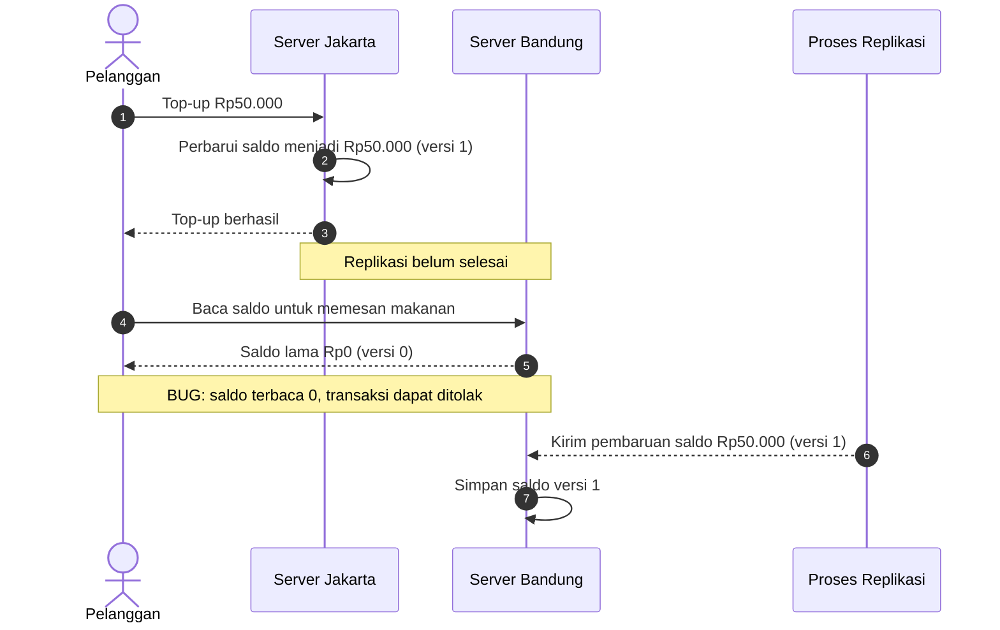
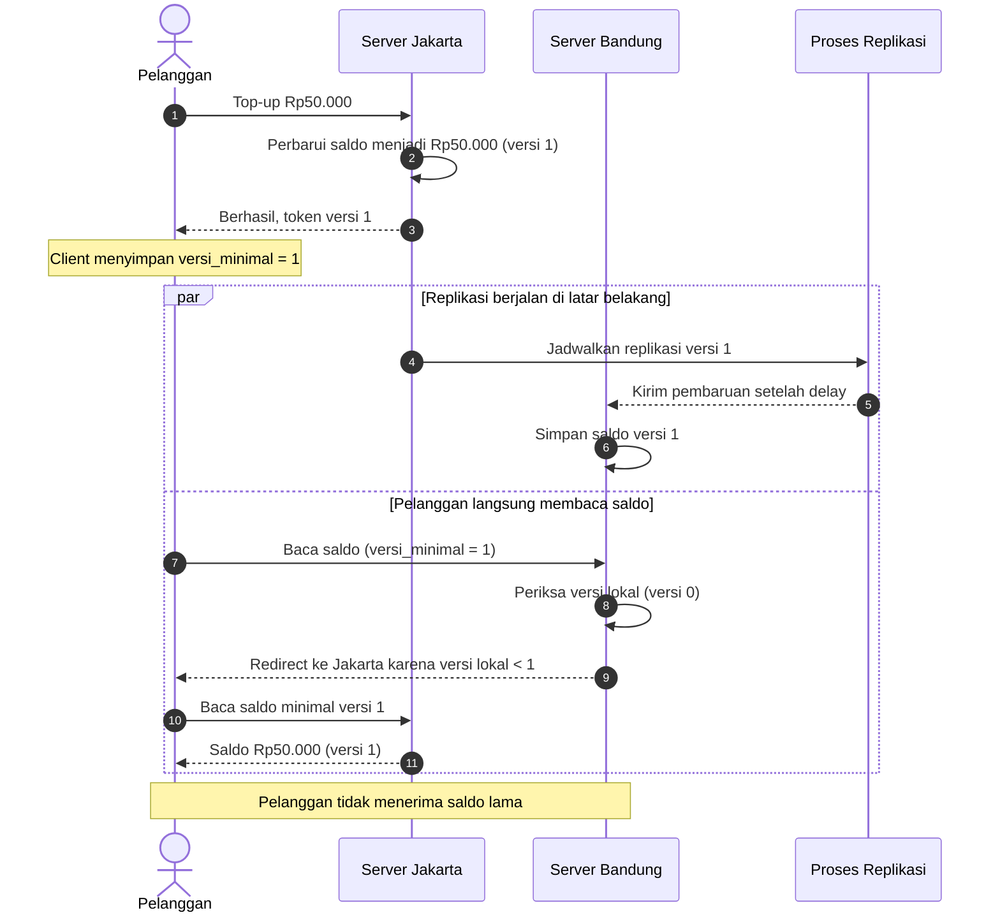

# Tugas 7 (Pekan 7) — Konsistensi Data

**Materi terkait:** Data-Centric Consistency (Sequential, Eventual), Client-Centric Consistency.

## Studi Kasus

Data saldo *e-wallet* pelanggan FoodGo berbeda antara server wilayah **Jakarta** dan **Bandung** karena replikasi antar server berjalan lambat. Contoh kasus nyata: pelanggan top-up saldo lewat server Jakarta, lalu dalam hitungan detik memesan makanan lewat aplikasi yang tersambung ke server Bandung — saldo belum ter-update, transaksi ditolak padahal saldo sebenarnya cukup.

## Tugas Kelompok

### Bagian 1 — Analisis (wajib)

1. Tentukan: apakah kasus ini **membutuhkan Sequential Consistency** (semua replika melihat urutan operasi yang sama) atau **cukup Eventual Consistency** (replika akan konsisten "pada akhirnya", boleh sementara berbeda)? Berikan argumen berbasis dampak bisnis (mis. kasus saldo *e-wallet* jauh lebih sensitif dibanding kasus "jumlah like" di media sosial).
2. Jika kalian menyimpulkan Eventual Consistency saja **tidak cukup** untuk skenario ini, usulkan pendekatan **Client-Centric Consistency** yang relevan (mis. *Read-Your-Writes*: pelanggan yang baru top-up harus selalu melihat saldo terbarunya sendiri, walau replika lain belum sinkron).
3. Gambarkan **diagram alir urutan (sequence diagram)** yang menunjukkan operasi read/write antara pelanggan, server Jakarta, server Bandung, dan proses replikasi — untuk skenario **tanpa** jaminan konsistensi (bug terjadi) DAN skenario **dengan** solusi yang kalian usulkan (bug teratasi). Pakai Mermaid (`sequenceDiagram`) di `README.md` — lihat contoh cara pakai di Tugas 2.

JAWAB :

### 1. Pemilihan model konsistensi (LAURA CHYNDEARNI SARAGIH)

Kasus saldo e-wallet FoodGo **tidak cukup ditangani dengan Eventual Consistency saja**. Eventual Consistency memperbolehkan replika memiliki data yang berbeda untuk sementara waktu. Replika baru akan memiliki data yang sama setelah tidak ada pembaruan baru dan seluruh pembaruan selesai dipropagasikan.

Model tersebut cocok untuk data yang dampak keterlambatannya rendah, misalnya jumlah *like* di media sosial. Jika jumlah *like* di Jakarta dan Bandung berbeda selama beberapa detik, dampak bisnisnya relatif kecil. Sebaliknya, saldo e-wallet adalah data keuangan. Saldo yang terbaca lebih rendah dapat menyebabkan transaksi pelanggan ditolak, sedangkan saldo yang terbaca lebih tinggi berisiko menyebabkan pengeluaran melebihi saldo sebenarnya apabila dipakai tanpa validasi transaksi yang benar.

Sequential Consistency memberikan jaminan urutan global: hasil eksekusi harus sama dengan suatu urutan sekuensial yang mempertahankan urutan operasi setiap proses. Jaminan ini lebih kuat daripada Eventual Consistency, tetapi penerapannya dapat membutuhkan koordinasi antarreplika dan berdampak pada kinerja serta skalabilitas.

Untuk ruang lingkup masalah yang diberikan, pendekatan yang dipilih adalah **Eventual Consistency untuk replikasi umum, ditambah Client-Centric Consistency berupa Read-Your-Writes untuk sesi pelanggan**. Jadi, kita tidak menganggap Eventual Consistency saja sudah cukup. Pelanggan yang baru melakukan top-up harus dapat membaca hasil top-up tersebut meskipun membaca melalui server Bandung sebelum replikasi selesai.

Catatan: Read-Your-Writes menjamin pelanggan melihat efek tulisannya sendiri, bukan menjamin seluruh transaksi keuangan aman terhadap dua pembelian bersamaan. Saat melakukan debit/pemesanan, FoodGo tetap harus memvalidasi saldo dan melakukan pengurangan saldo secara atomik pada sumber data yang berwenang/terkoordinasi agar saldo tidak terpakai dua kali.

### 2. Usulan Client-Centric Consistency: Read-Your-Writes (LAURA CHYNDEARNI SARAGIH)

Setiap operasi penulisan saldo diberi nomor versi. Setelah top-up berhasil di server Jakarta, aplikasi menyimpan versi minimum yang harus terlihat oleh pelanggan tersebut (`versi_minimal`). Ketika pelanggan meminta saldo melalui server Bandung:

1. Client mengirim `user_id` dan `versi_minimal`.
2. Server Bandung memeriksa versi saldo lokal.
3. Jika versi Bandung sudah sama atau lebih besar dari `versi_minimal`, Bandung boleh mengembalikan saldo lokal.
4. Jika versi Bandung masih lebih kecil, server tidak boleh mengembalikan saldo lama. Pada simulasi ini, permintaan dialihkan ke server Jakarta sebagai server yang sudah memiliki versi terbaru.
5. Setelah replikasi selesai, Bandung juga memiliki versi tersebut dan dapat melayani pembacaan berikutnya.

Dengan demikian, efek operasi `top_up` oleh pelanggan selalu terlihat pada pembacaan berikutnya oleh pelanggan yang sama. Mekanisme ini sesuai dengan definisi Read-Your-Writes pada materi: efek operasi write oleh suatu proses pada data item harus terlihat pada operasi read berikutnya oleh proses yang sama.

### 3. Sequence diagram (YOHANNA PURNOMO)

#### A. Tanpa jaminan Read-Your-Writes (bug terjadi)



## B. Dengan Read-Your-Writes (bug teratasi)



**Kesimpulan:** Replikasi tetap dapat berjalan secara eventual untuk menjaga kinerja, tetapi pembacaan saldo oleh pelanggan harus memenuhi Read-Your-Writes. Jika replika tujuan belum mencapai versi yang diminta, pembacaan diarahkan ke replika yang sudah memiliki versi tersebut.

### Bagian 2 — Simulasi (opsional, nilai tambah)

Skeleton `src/replica_simulation.py` mensimulasikan dua replika (Jakarta & Bandung) dengan delay replikasi buatan. Lengkapi TODO untuk:

1. Menunjukkan kondisi **inconsistent read** (replika Bandung masih menunjukkan saldo lama walau Jakarta sudah update).
2. Mengimplementasikan mekanisme **Read-Your-Writes** sederhana (mis. dengan version/timestamp per client) yang memperbaiki masalah tersebut.

```bash
python3 src/replica_simulation.py
```

## Struktur Submission

```
tugas-07-konsistensi-data/
├── README.md      # Analisis konsistensi + sequence diagram Mermaid
├── JURNAL.md
├── src/            # (opsional) simulasi replikasi
└── bukti/          # (jika mengerjakan simulasi) output program
```

## Rubrik Penilaian (Tugas 7)

| Komponen                              | Bobot | Kriteria                                                          |
| ------------------------------------- | ----- | ----------------------------------------------------------------- |
| Ketepatan pemilihan model konsistensi | 30%   | Argumen berbasis dampak bisnis nyata, bukan hafalan definisi      |
| Kualitas sequence diagram             | 30%   | Menunjukkan jelas titik kegagalan & titik perbaikan               |
| Usulan solusi client-centric          | 25%   | Solusi konkret dan dapat diimplementasikan (bukan wacana abstrak) |
| Proses & kontribusi kelompok          | 15%   | `JURNAL.md`, commit history (+ bonus jika simulasi dikerjakan)  |

## Batasan Penggunaan AI (Level 2)

Kebijakan **Level 2 (AI Assisted Idea Generation & Structuring)** berlaku — lihat [`../RUBRIK-UMUM.md`](../RUBRIK-UMUM.md). Boleh bertanya konsep umum consistency model ke AI untuk brainstorming; **tidak boleh** meminta AI menuliskan analisis akhir/sequence diagram atau isi `# TODO` di `src/replica_simulation.py` yang tinggal ditempel. Catat pemakaian AI di "Log Penggunaan AI" pada `JURNAL.md`.

- Sebagai bukti pemahaman konsep (bukan hafalan jawaban skenario FoodGo saja), `README.md` wajib menyertakan **satu skenario tambahan** yang kalian buat sendiri (mis. kasus lain di aplikasi ojek online) dan menentukan model konsistensi yang tepat untuk skenario tambahan tersebut.
